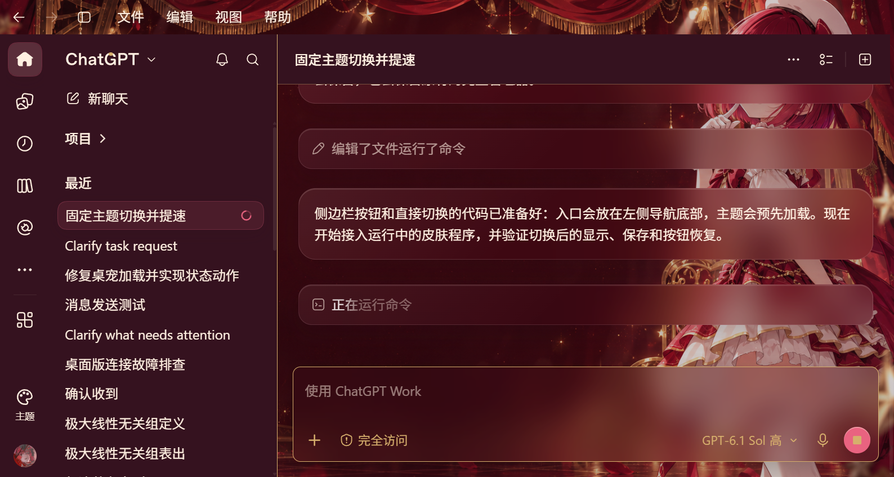
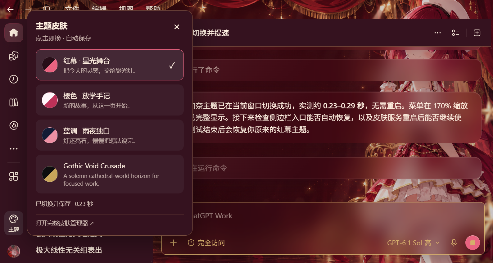
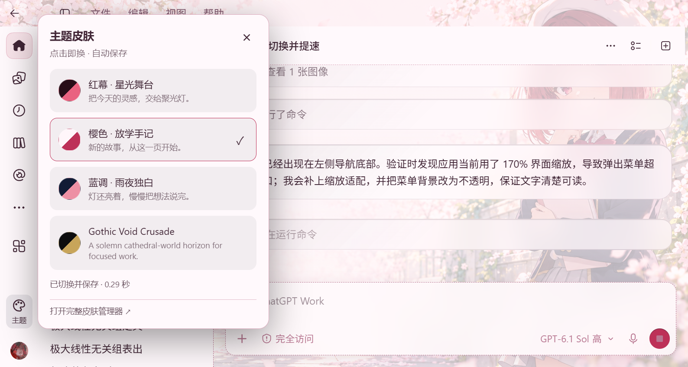
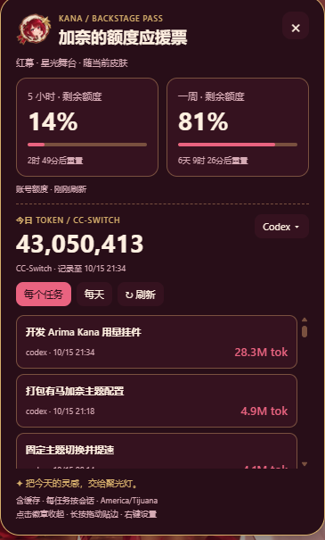

<div align="center">

# 有马加奈 GPT 完整主题包

**把 Windows 桌面版 ChatGPT / Codex 变成一套完整、有状态、可切换的有马加奈工作空间。**

三套全界面皮肤 · 迷你加奈 Pet · 页面内嵌额度挂件 · 侧边栏快速切换 · 自动安装与验收


</div>



## 这是什么？

这不是只换一张背景图，而是一套面向 Windows 桌面版 ChatGPT / Codex 的完整视觉与陪伴系统。

它会统一侧边栏、对话区、输入框、卡片、菜单、弹窗、下拉框和状态提示；左侧栏保留常驻主题入口，可在三套风格间快速切换。主题包还包含会响应工作状态的「迷你加奈」Pet，以及直接嵌入 GPT 页面、与主题联动的额度挂件。

当前默认应用 **「樱色 · 放学手记」**，也可以随时切换到红幕或蓝调主题。

## 2026.10.16.2 更新

- 同步当前正在运行的“樱色 · 放学手记”作为默认主题。
- 更新全局 DreamSkin 样式，增强浅色主题下文字、卡片、输入区与浮层的可读性。
- 清理旧包中不应发布的运行状态、回滚记录和备份样式文件。
- 保留目标电脑 Pet ID 自动解析、内嵌额度挂件与三主题联动。

## 主要特色

- **三套完整主题**：每套都有独立背景、面板、强调色、文字层级与氛围，不是简单换色。
- **覆盖主要界面**：侧边栏、对话、Composer、菜单、弹窗、列表、提示层与浮层统一适配。
- **常驻切换入口**：左侧导航底部固定主题按钮，选择后立即应用并保存。
- **快速切换**：主题资源预加载，实测切换约 0.23–0.29 秒，无需重新安装。
- **迷你加奈 Pet**：待机、思考、成功、失败、等待、检查、阻塞和拖动都有对应动作。
- **本地加载兜底**：临时云端图片失效时，本地缓存仍可接管 Pet 显示。
- **页面内嵌额度挂件**：收起是头像徽章，点击展开“加奈的额度应援票”。
- **主题联动**：主题切换时，挂件配色、图片与提示音一起变化。
- **可迁移安装**：压缩包自带 GPT Work 安装指令、依赖、哈希清单与安装后检查。

## 三套主题

### 红幕 · 星光舞台

酒红、玫粉和金色构成舞台帷幕与聚光灯氛围，卡片保持深色半透明质感。

> 把今天的灵感，交给聚光灯。



### 樱色 · 放学手记

奶白、樱粉与玫瑰红组成明亮的校园手记风格；本次更新进一步提高文字、卡片、输入区和浮层的对比度。本版本安装后默认应用这一套。

> 新的故事，从这一页开始。



### 蓝调 · 雨夜独白

深蓝、银蓝与柔和粉色组成低饱和夜景，视觉更安静，适合长时间阅读、写作和深度工作。


> 灯还亮着，慢慢把想法说完。

## 页面内嵌额度挂件

新版挂件不再是单独的桌面程序，而是直接显示在 GPT 页面内。它不会在任务栏或托盘额外占一个应用，也不会脱离 GPT 窗口漂浮到其他软件上方。

收起时，它是一枚带有加奈头像的精简徽章；点击后展开完整面板，显示：

- Codex 五小时额度与一周额度
- 下次额度重置时间
- cc-switch 今日 token 汇总
- 任务明细与日期统计
- Codex / 全部应用范围切换

长拖可以把挂件吸附到最近的页面边缘；右键可以切换音效、大小或恢复默认位置。数据每 5 秒刷新一次。

<table>
  <tr>
    <th>收起后的加奈徽章</th>
    <th>展开后的额度应援票</th>
  </tr>
  <tr>
    <td></td>
    <td></td>
  </tr>
</table>

## 迷你加奈 Pet

自定义 Pet 使用透明 v2 spritesheet，尺寸为 **1536 × 2288**，包含 73 个必需动画帧。

| 工作状态 | 动作效果 |
| --- | --- |
| 待机 | 站立、眨眼、轻微呼吸 |
| 思考 / 运行中 | 专注思考动作 |
| 成功 | 跳跃庆祝，随后进入检查状态 |
| 失败 | 沮丧或低落动作 |
| 需要许可 / 被阻塞 | 阻塞状态反馈 |
| 检查 | 观察与确认动作 |
| 等待回复 | 安静等待并保持响应 |
| 拖动 | 根据移动方向切换左右步态 |


<div align="center">
  
  <br>
  
</div>

Pet 素材同时保存在本地守护目录。临时图片地址失效、请求失败或解码失败时，本地节点会接管，避免出现“底栏还在，但人物消失”。

## 包内包含什么？

```text
有马加奈 GPT 完整主题包
├─ DreamSkin
│  ├─ 三套主题与背景素材
│  ├─ 全界面样式注入器
│  ├─ 侧边栏主题入口
│  ├─ 快速主题切换与回滚
│  └─ 离线 Node 运行环境
├─ ThemeControls
│  ├─ 加奈主题启动入口
│  ├─ 托盘控制与主题桥
│  └─ 桌面 / 开始菜单图标
├─ KanaPet
│  ├─ 迷你加奈 spritesheet
│  ├─ 状态动画映射
│  └─ 本地缓存与加载守护
├─ KanaUsageEmbedded
│  ├─ 页面内嵌徽章与展开面板
│  ├─ 三套主题素材与提示音
│  ├─ 本地用量读取器
│  └─ 贴边、缩放、音效与复位逻辑
├─ GitHub README 与效果图
├─ 自动安装脚本
├─ 安装后检查脚本
└─ SHA-256 文件清单
```

## 下载与安装

### 推荐：交给 GPT Work 自动安装

1. 从本仓库 Releases 下载完整 ZIP。
2. 把 ZIP 交给另一台 Windows 桌面版 GPT 的 Work。
3. 输入：

```text
帮我把主题包安装到gpt并应用
```

GPT 会按包内指令自动：

1. 完整解压并核对所有文件的 SHA-256。
2. 检查或创建目标账号自己的「迷你加奈」Pet。
3. 安装 DreamSkin、三套主题、主题控制入口和页面内嵌额度挂件。
4. 安装 Pet 本地缓存与状态动画守护。
5. 移除旧版独立 Kana Meter，避免重复显示。
6. 关闭并重新打开桌面版 GPT。
7. 应用“樱色 · 放学手记”。
8. 运行安装后检查并输出结果。

### 手动安装

完整解压后运行：

```powershell
powershell.exe -NoProfile -ExecutionPolicy Bypass -File .\verify-package.ps1
powershell.exe -NoProfile -ExecutionPolicy Bypass -File .\install.ps1 -AllowRestart
```

手动安装时，自定义 Pet 仍需在 GPT 的 Pets 设置中上传 `payload\KanaPet\spritesheet.png` 并选中。

## 运行要求

- Windows 10/11 x64
- 已安装并登录 OpenAI ChatGPT/Codex 桌面应用
- 账号或工作区允许使用 Pets
- Python 3.11+；安装程序会优先寻找桌面版 GPT 自带的 Codex Python
- 安装前保存尚未发送的文字，因为安装过程需要重启桌面应用

## 隐私与安全

- 不包含登录凭据、Cookie、浏览器资料或聊天记录。
- 不包含账号额度快照、cc-switch 数据库或个人历史统计。
- 不携带旧电脑用户名路径；Python 与应用路径在目标电脑重新探测。
- 不修改 WindowsApps 内的官方 ChatGPT/Codex 安装文件。
- 不复用旧账号的 Pet ID 或临时资源 URL。
- 每个文件都写入 SHA-256 清单，安装前自动校验。
- 安装前会备份已有主题、主题控制和 Pet 本地守护文件。

## 已验证项目

- 三套主题均能加载并保存选择。
- 侧边栏入口、主题菜单和自动恢复正常。
- 快速切换实测约 0.23–0.29 秒。
- Pet spritesheet 通过 v2 结构检查：1536 × 2288、73 帧。
- 远程 Pet 图片被阻断时，本地人物仍能显示。
- Pet 的状态映射与恢复检查通过。
- 内嵌挂件可折叠、展开、贴边，并随主题同步。
- 包内机器专属路径已清除，目标机安装时重新生成。
- 完整压缩包会经过解压回环与 SHA-256 校验。

## 说明

自定义桌面 Pet 保存在本机，不会自动同步到另一台设备，所以目标电脑需要由 GPT 的 Pets 工具重新创建或选择「迷你加奈」。详见 [OpenAI Pets 文档](https://learn.chatgpt.com/docs/pets?surface=app&translationFallback=zh-Hant)。

桌面应用更新后，页面结构或功能权限可能变化。本项目包含自动恢复和验证逻辑；如果安装后检查失败，请附上 `%LOCALAPPDATA%\ArimaKanaThemePack\install-report.json` 与应用版本提交 Issue。

## 非官方声明

这是个人使用的非官方同人主题项目，不是 OpenAI 官方扩展，也不是角色官方商品。ChatGPT、Codex 与 OpenAI 名称归其各自权利人所有；角色相关权利归原权利人所有。
